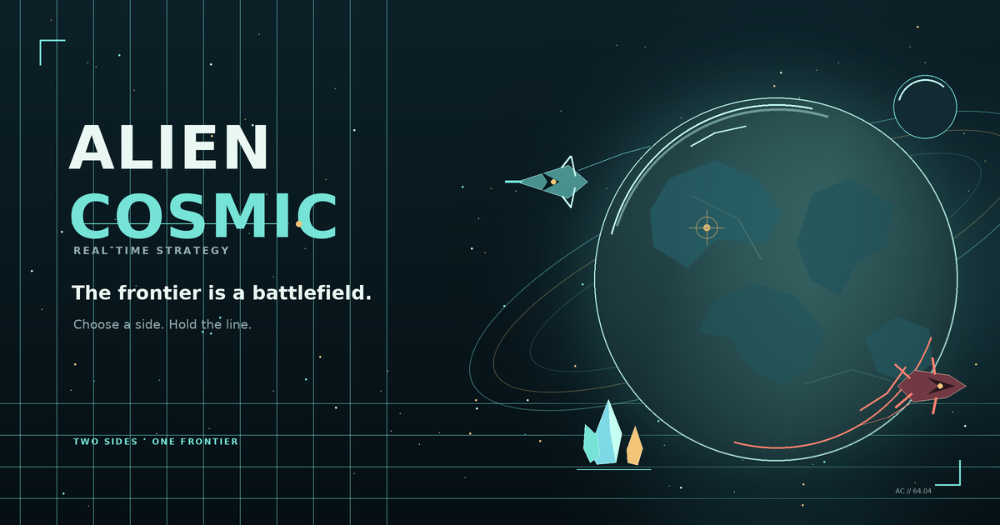

# 👽 Alien Cosmic

[](https://bestdeejay-design.github.io/alien-cosmic/)
[](README.ru.md)
[](#technical-highlights)



**Alien Cosmic** is a classic real-time strategy that runs entirely in your
browser. Lead human colonists or the alien Kharid hive across distant worlds:
build bases, harvest crystals, research upgrades and fight through a
15-mission campaign. No install, no accounts — open the page and play.

**🇷🇺 Русская версия этого README: [README.ru.md](README.ru.md).**

## Why it's different

- **Alien planets as a character.** Three biomes (the rusted Actan-4, the violet
  hive wastelands of Brok-Thaal, the regolith of Selenite-B) are not skins but
  story scenes: colonial mining fields, sacred kharid cradles, abandoned lunar
  quarries.
- **Conflict with a point of view.** Both sides have their own truth: Helios
  sees crystals as fuel and profit, the kharid see them as brood cradles. The
  story is designed to develop in both directions (see [ROADMAP.md](ROADMAP.md), phase Ф5).
- **Nothing dead-ends.** A worker dies on a construction site — the site stalls
  but any other worker can finish it. A barracks exit is blocked — the unit
  waits by the gates instead of getting stuck. Crystals are distributed without
  crowding. Everything the player sees can be resolved with a deliberate action.
- **Auto-modes remove the routine.** Workers return to harvesting after
  building, fighters shoot on the move without dropping orders, nanites heal
  while marching, double-click selects all units of the same type. The routine
  is off the player's shoulders — the strategy stays.
- **Built for multiplayer.** The architecture (fixed-step simulation,
  command-based orders) is designed so replays, lobbies and PvP can be built
  on top of it later (see [ARCHITECTURE.md](ARCHITECTURE.md)).

## What's inside

| Section | Content |
|---|---|
| 🎬 **Campaign 15/3** | 15 missions in 3 acts: tutorial, timed defenses, fort assaults, a stealth raid without a base, a finale against an enemy with a full arsenal. Progress is saved |
| 🚀 **Local raids (R0-a)** | Permanent Command Ship home base on beginner planet Actan-4, one-time starter squad, loadout tiers 1–5, seeded target sectors, erg delivery to the shuttle pad and boarding evacuation back to base |
| 🧬 **Three factions** | Helios (humans: machines and concrete), kharid (swarm: hive organics) and the "Red Flag" rebels — mirrored stats, distinct looks, names and buildings |
| 🏗 **8 buildings** | Command center/hive, House/depot, Barracks/incubator, Turret/mandible, Bunker/cocoon, Wall/chitin, Vehicle plant/brood pit, Lab/evolution node |
| 🚙 **8 units × 2 skins** | Helios: Tech Drone, Ranger, Nanite (healing), Plasmer (splash), Skiff, Bastion, Nova Mortar (12.5-tile range), Pathfinder (recon). Kharid: Gatherer, Shardjaw, Bloom, Acid Spitter, Skitter, Bruiser, Sporehulk, Listener |
| 🔬 **Upgrades** | 4 branches × 3 levels: infantry weapons/armor, vehicle guns/plating. The AI researches too |
| 🤖 **Auto-modes** | Attack-move (A + click), fire while holding an order, auto-return of workers to harvesting, rally point on a crystal = auto-harvest, spaced spawn, no crystal crowding, double-click select-same, nanites heal on the march, anti-stuck: re-path, side-step and push-out of buildings |
| 🖼 **Tooltips on everything** | Every button explains cost, stats and role. The production queue is always visible — with a timer and cancellation |
| 🔧 **Repair** | Workers repair buildings and vehicles for minerals (right-click a damaged one) |
| 🗺 **Planet biomes** | Martian wastes with craters, violet hive wastes, lunar plains — a map generator with symmetry and guaranteed passability |
| 🤖 **Enemy AI** | Economy, housing, barracks with mixed infantry, vehicles up to mortars, labs, repair, attack waves; defense missions bring waves from nests |
| 💥 **Effects** | Screen shake from explosions, smoke from damaged buildings, debris, flashes, green healing crosses |
| 🔊 **Sound** | Synthesized with Web Audio: gunfire, cannon, welding, explosions, fanfares |
| 👁 **Fog of war** | Three cell states, remembered buildings stay on the map |

## Controls

| Action | Keys |
|---|---|
| Select / box-select | LMB, LMB-drag |
| All same-type units on screen | double-click/tap a unit |
| Order (move/harvest/attack/repair) | RMB on ground/crystal/enemy/own |
| **Attack-move** | **A**, then LMB on the point (RMB/Esc to cancel) |
| Building rally point | select building → RMB; **on a crystal — new workers start harvesting** |
| Groups | Ctrl/Shift + 1…9 (assign), 1…9 (select) |
| Build | B (or Q/W/E/R/T/Y/U/I), LMB — place |
| Stop | S |
| Camera | arrows, screen edge, MMB-drag, Space — jump to base |
| Pause | P |

## Run it

Any static server works (ES modules don't load from `file://`):

```bash
python3 -m http.server 8080
# open http://localhost:8080/
```

No dependencies, no build step, no network — just a browser.
Or play right now: **https://bestdeejay-design.github.io/alien-cosmic/**

## Repository structure

```
index.html        — markup (menu, campaign, briefing, HUD)
style.css         — interface styles
js/
  config.js       — ALL the balance: units, buildings, upgrades, biomes, AI
  map.js          — map generator (3 biomes, symmetry, passability)
  pathfinding.js  — grid A*, paths to rectangles
  units.js        — units: orders, movement, harvesting, building, combat
  buildings.js    — buildings: queues, turrets, garrisons, spawning
  ai.js           — enemy AI (mission profiles)
  missions.js     — 15 missions / 3 acts, progress
  raid.js         — local raid loop (home Command Ship, tiers 1–5, shuttle pad)
  fog.js          — fog of war
  input.js        — controls and camera
  ui.js           — command panel, tooltips, minimap, menu
  audio.js        — sound synthesis (Web Audio)
  game.js         — entry point, game loop, victory/defeat
scripts/
  check.mjs       — static validator (syntax, imports, html)
CAMPAIGN.md       — campaign architecture and story arc
GAME_GUIDE.md     — full reference: story, factions, units, missions (RU)
GAME_GUIDE.en.md  — full reference (EN)
LORE.md / LORE.en.md — world lore (RU/EN)
RESEARCH_CLASSIC_RTS.md — classic RTS research (references)
ROADMAP.md        — development plan (phases 2…7)
ARCHITECTURE.md   — architecture and the path to multiplayer
```

## Technical highlights

- **Pure JavaScript**: ES modules, Canvas 2D, Web Audio. No frameworks, no
  bundlers, no runtime dependencies, no network requests — the whole game is
  static files on GitHub Pages.
- **Fixed-step simulation** with command-based orders — deterministic by
  design, ready for replays and future multiplayer.
- **Balance lives in one file** (`js/config.js`), so tuning doesn't touch
  engine code.

## Lineage

| Version | What it gave Alien Cosmic |
|---|---|
| **"Zvezdny Rubeg" 3.0** (`terran-rts`) | 15/3 campaign, two races + a third force, vehicles, upgrades, tooltips, biomes — the whole content layer |
| **"Rubezh 64"** (`minigames/rubezh64`) | auto-modes, spaced spawning, anti-crowding, difficulty selection — the engine layer (phase 1) |

The prototypes are archived as a reference for ideas; new mechanics appear
only here.

---

Earth needs the crystals. The hive needs its cradles.
Whoever you lead — the frontier keeps score. 🛸
