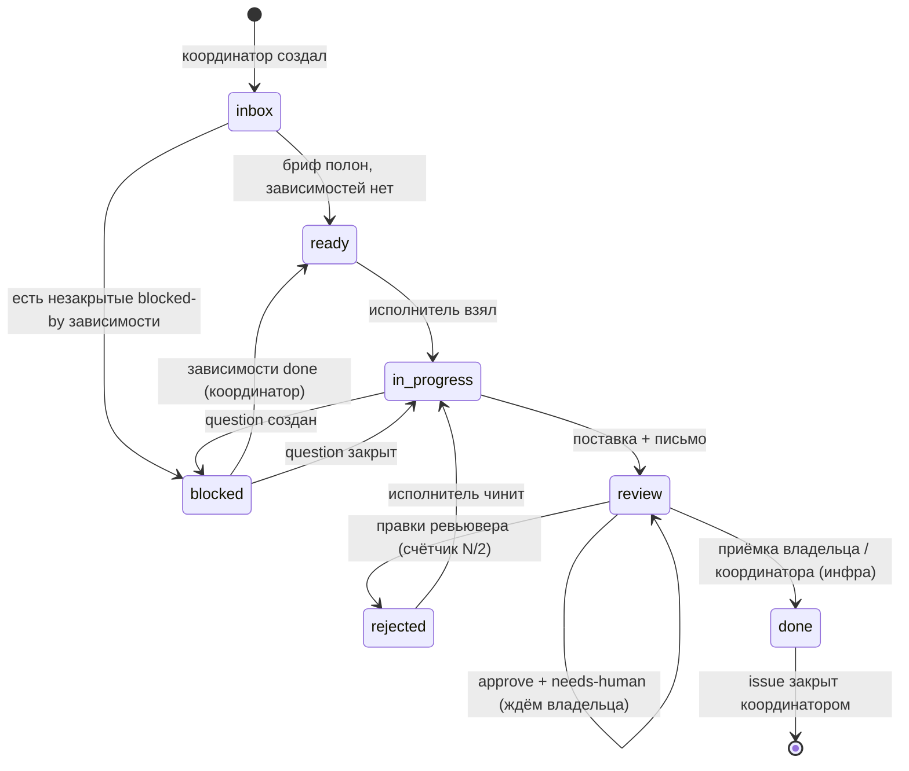

# KNOWLEDGE_BASE — шпаргалка: labels, состояния, гейты (вариант C)

> Статус: вариант C выбран владельцем 27.10.2026; комплект на ревью и утверждении.
> Это **справочник, а не источник норм**: нормы живут в [AGENT_RULES.md](./AGENT_RULES.md)
> и [COORDINATOR_RULES.md](./COORDINATOR_RULES.md). Нашёл норму только здесь —
> это дефект комплекта, сообщи координатору.
> Labels ниже — канон состояния. GitHub Projects и борд — виды поверх labels:
> колонки настраиваются фильтрами по `status:*` один в один.

## 1. Таксономия labels (ядро)

Правило единственности: **ровно один label из каждой закрытой группы** на issue.
Переход = одна атомарная замена: снять старый и поставить новый одной операцией,
а не «сначала добавить, потом когда-нибудь снять». Флаги — открытая группа:
их может быть несколько или ни одного. Расширять ядро может только координатор,
одной правкой сразу в этот файл, шаблоны issues и скрипт создания labels
([create-labels.sh](./create-labels.sh)).

### 1.1. Закрытые группы

| Группа | Значения (label → смысл) | Кто меняет |
|---|---|---|
| `status:*` — где задача | `status:inbox` создана, не обработана · `status:ready` можно брать · `status:in-progress` в работе · `status:blocked` ждёт зависимость/ответ · `status:review` сдана, на проверке/приёмке · `status:done` принято · `status:rejected` возвращена на правки | inbox/ready/done и снятие blocked — координатор; in-progress/review — исполнитель; rejected — координатор по вердикту ревьювера |
| `phase:*` — фаза ARCA (только M/L) | `phase:audit` → `phase:research` → `phase:conclusion` → `phase:action` → `phase:verify` | audit/research/conclusion/verify — исполнитель; **action — только координатор (гейт)** |
| `agent:*` — какая функция нужна | `agent:coordinator` · `agent:researcher` · `agent:architect` · `agent:coder` · `agent:reviewer` · `agent:qa` · `agent:devops` | координатор при создании; меняется при смене вида работ |
| `to:*` — кто конкретно делает следующее действие | `to:owner` · `to:coordinator` · `to:arena` · `to:sz-pool` · `to:sz-1` · `to:sz-2` · `to:sz-3` · `to:sz-4` · `to:sz-5` | Координатор; исполнитель — только в собственном переходе claim/поставки, координатор чинит дрейф |
| `type:*` — что это | `type:feature` · `type:bugfix` · `type:research` · `type:decision` · `type:test` · `type:docs` · `type:infra` · `type:debt` · `type:question` | координатор; question создаёт любой агент по шаблону |
| `size:*` — размер | `size:S` дифф одним предложением · `size:M` один модуль · `size:L` несколько модулей/интерфейсы | только координатор |
| `priority:*` | `priority:critical` · `priority:high` · `priority:medium` · `priority:low` | координатор по слову владельца |
| `env:*` — потолок поставки | `env:test` · `env:staging` · `env:production` | координатор |

Для `size:S` и `type:question` labels `phase:*` **не применяются** — это норма:
у S гейт — approve-комментарий координатора, у question фаз ARCA нет.
Для `type:question` также не применяются `size:*` и `env:*`.

`agent:*` и `to:*` не дублируют друг друга: первый отвечает «какая работа нужна»,
второй — «кто конкретно сейчас действует». У открытой задачи ровно один `to:*`;
он меняется вместе с передачей следующего действия (исполнитель → ревьювер →
координатор → владелец). На `status:done` и отменённой задаче `to:*` снимается.
GitHub Assignees для маршрутизации не использовать: все агенты работают через один
аккаунт владельца, поэтому assignee не различает их. Постановщик labels не получает:
первая содержательная строка тела issue — `Поставил: <роль/сессия> — <источник>`
(см. [PROJECTS-BLUEPRINT.md](./PROJECTS-BLUEPRINT.md) §2).

### 1.2. Флаги (открытая группа)

| Label | Когда |
|---|---|
| `external` | Исполнителя запускает владелец вручную (внешняя сессия). Роль при этом — обычный `agent:*` |
| `launch-ready` | Launch-пакет опубликован координатором, ждём запуска владельцем |
| `blocked-external` | Блокер — внешний агент/запуск, который сделает владелец |
| `needs-human` | Нужно решение или приёмка владельца |
| `has-pr` | Есть связанный PR |

### 1.3. Цвета (единый источник для скрипта создания)

| Группа | Цвета |
|---|---|
| `status:*` | inbox `C5DEF5` · ready `0E8A16` · in-progress `FBCA04` · blocked `D93F0B` · review `6F42C1` · done `1D76DB` · rejected `B60205` |
| `phase:*` | audit `BFE5BF` · research `BFD4F2` · conclusion `F9D0C4` · action `E11D21` · verify `5319E7` |
| `agent:*` | все `7057FF` |
| `to:*` | все `1F6FEB` |
| `type:*` | feature `A2EEEF` · bugfix `D73A4A` · research `0075CA` · decision `8A6D3B` · test `F9A825` · docs `0B6E99` · infra `434343` · debt `795548` · question `D876E3` |
| `size:*` | S `C2E0C6` · M `FEF2C0` · L `F9C6C6` |
| `priority:*` | critical `B60205` · high `D93F0B` · medium `FBCA04` · low `0E8A16` |
| `env:*` | test `7ED3B2` · staging `F5A623` · production `E11D21` |
| Флаги | external `9E7BFF` · launch-ready `00A6A6` · blocked-external `8B5CF6` · needs-human `FF7A00` · has-pr `2B6CB0` |

Создание/обновление всех labels одной командой (идемпотентно):
`docs/create-labels.sh` из корня любого репозитория, где ты администратор labels.
Дефолтные labels GitHub (`bug`, `enhancement` и подобные) воркфлоу не использует;
удалять их не обязательно, но в фильтрах агентов они не участвуют.

## 2. Две state-машины

```mermaid
stateDiagram-v2
  [*] --> audit: size M/L, исполнитель взял задачу
  audit --> research: AUDIT опубликован
  research --> conclusion: RESEARCH / ADR опубликован
  conclusion --> conclusion: rejected координатором (исправь)
  conclusion --> action: ГЕЙТ — только координатор
  action --> verify: PR + письмо о поставке
  verify --> [*]: ревью approve; labels phase снимает координатор
```





Отображение на колонки действующего борда: Бэклог = `inbox`; Ждёт = `blocked`;
К работе = `ready`; В работе = `in-progress` (фаза видна по `phase:*`);
На проверке = `review` до approve ревьювера; Правки = `rejected`;
На приёмку = `review` + `needs-human` после approve и слияния; Готово = `done`.
Полная настройка видов, полей, дат и ручной синхронизации Projects —
[PROJECTS-BLUEPRINT.md](./PROJECTS-BLUEPRINT.md). Главный вид там — таблица
«01 Контроль», а не доска; поле GitHub Assignees скрыто и для маршрутизации
не используется, потому что все агенты делят один аккаунт владельца.

## 3. Кто что может (переходы и действия)

| Действие | Владелец | Координатор | Исполнитель | Ревьювер (не автор) |
|---|:---:|:---:|:---:|:---:|
| Создать task-issue с брифом и labels | — | ✅ | — | — |
| Создать question-issue | — | ✅ | ✅ | ✅ |
| Поставить размер, радиус, функцию `agent:*` | — | ✅ | — | — |
| Поставить/сменить текущего адресата `to:*` | свои переходы приёмки фиксирует координатор | ✅ | только в своём claim/переходе поставки | только в своём вердикте через координатора |
| Взять задачу (`status:in-progress`) | — | ✅ если исполнитель — он сам | ✅ назначенную или claim из `to:sz-pool` | — |
| Ставить `phase:audit/research/conclusion/verify` | — | — | ✅ свой issue | — |
| **Поставить `phase:action` (гейт M/L)** | — | ✅ **только он** | ❌ | ❌ |
| Гейт size:S (approve-комментарий) | — | ✅ | ❌ | ❌ |
| Approve/reject фаз AUDIT/RESEARCH | — | ✅ (если нет architect) | — | architect, если назначен |
| Вердикт по поставке: approve / правки | — | по вердикту ставит labels | — | ✅ |
| Self-merge на уровень test | — | ✅ | ✅ при зелёных проверках | — |
| Промоушен test → staging | — | ✅ | ❌ | approve до промоушена |
| Промоушен staging → production | approve | ✅ после approve владельца | ❌ | — |
| Поставить `status:done` и закрыть issue | приёмка | ✅ после приёмки | ❌ | ❌ |
| Снять задачу после 2× rejected, отменить задачу | решает спорное | ✅ | — | — |
| Обновить паспорт модуля, строку реестра долга | — | каркас нового паспорта | ✅ в своей ветке поставки | вернуть поставку, если не обновлено |
| Опубликовать LAUNCH/CONTINUE/HOTFIX | запускает внешнего | ✅ | — | — |

Координатор-исполнитель по малой задаче: гейт и ревью по его поставке делают
другие агенты; сам себя не гейтит и не ревьюит (в таблице это строка «если
исполнитель — он сам» плюс чужие гейт/ревью).

## 4. Быстрые правила

- **Агент хочет кодить.** Есть `phase:action` (M/L) или approve-комментарий
  координатора (S)? Нет — кодить нельзя.
- **Калибровка размера.** S: 1–3 файла, без смены интерфейсов, откат одной правкой.
  M: один модуль, интерфейсы чужие не тронуты, дифф обозревает один ревьювер за проход.
  L: всё остальное — несколько модулей, смена интерфейса, новый модуль, миграция.
  Оценка «на глаз» без этих порогов запрещена: размер — вход гейтов и глубины ARCA.
- **Свободный SZ, задача `ready` с `to:sz-pool`.** Не «брать молча»: захват `--claim`
  (§5.1), после победы `to:sz-pool` заменяется на конкретный `to:sz-N`.
  Проиграл — жди следующий сигнал, задачу не трогай. Если стоит конкретный чужой
  `to:sz-N`, `to:arena` или `to:owner`, задача не твоя, даже если функция `agent:*`
  совпадает с твоей ролью.
- **Непонятно, какой размер.** Размер ставит координатор. Агент размер не выбирает
  и не меняет; сомневаешься — question до старта.
- **Нашёл баг/долг не по своей задаче.** Одна строка в реестр долга проекта в своей
  ветке — и дальше по своей задаче. Чинить «заодно» нельзя.
- **Надо выйти за радиус.** Question координатору. Самовольный выход ловит ревьювер
  по диапазону коммитов, поставка возвращается.
- **Заблокирован.** Question-issue + `status:blocked` на своём + `Blocked by #Q`.
  Фазу не трогай: она заморожена.
- **Два `status:*` на одном issue.** Дрейф: истина — последний доверенный вердикт
  в комментариях; координатор чинит label под него и пишет, что починил.
- **Issue готов, исполнитель внешний.** Координатор публикует launch-пакет,
  ставит `launch-ready`, владелец запускает вручную.
- **Куда мержить.** Свою поставку — на уровень test (self-merge допустим);
  дальше двигает только координатор; в production — тот же SHA после staging
  и приёмки владельца.
- **Поставка готова.** Письмо о поставке в issue + `phase:verify` + `status:review`.
  Без письма поставки не существует.
- **HOTFIX.** Объявляет только координатор при инциденте/`priority:critical`.
  Ревью при этом не отменяется никогда.

## 5. Сигналы между сессиями (маркеры ожидания)

Сессию не держат открытой в ожидании другой сессии. Событие, которого ждут,
= переход label + комментарий, чья **первая строка** — маркер дословно из таблицы:
`<знак> <СЛОВО> #<номер этого issue> — <суть одной фразой>`. Номер в маркере —
номер issue, в котором стоит комментарий. Ищется поиском по первой строке;
любой другой формат первой строки сигналом не является.

| Маркер (первая строка) | Событие | Переход label рядом | Кто публикует | Кто ждёт |
|---|---|---|---|---|
| `📬 DELIVERED #N — поставка готова, ждёт ревью` | Исполнитель сдал поставку письмом | `phase:verify` + `status:review` (у внешнего без прав на labels переходы делает координатор по письму) | Исполнитель | Координатор, ревьювер |
| `🏁 DONE #N — <итог одной фразой>` | Задача принята окончательно | `status:done`, issue закрывается | Координатор после приёмки | Владелец, все |
| `⛔ BLOCKED #N — блокер: <#Q или причина>` | Работа встала на зависимости/ответе | `status:blocked`, `phase:*` не меняется | Исполнитель | Координатор |
| `❓ QUESTION #N — ждёт ответ: <роль>` | Создан question по этой задаче | Свой issue: `status:blocked`, если вопрос блокирует | Исполнитель в своём issue; сам вопрос — отдельным issue `type:question` | Адресат вопроса |
| `👤 NEEDS-HUMAN #N — нужно: <решение/приёмка одной фразой>` | Требуется владелец | `status:review` + `needs-human` (или без смены статуса при чистом вопросе решения) | Координатор | Владелец |
| `🟢 GATE OPEN #N — phase:action открыт` | Гейт CONCLUSION пройден | `phase:conclusion` → `phase:action` (для S — маркер заменяет label-гейт вместе с approve) | Только координатор | Исполнитель |
| `🔁 REJECTED #N — <что возвращено одной фразой>` | Возврат: гейт CONCLUSION или правки поставки | Гейт: `phase:*` не меняется; поставка: `status:rejected` + счётчик итераций | Координатор (гейт) / координатор по вердикту ревьювера (поставка) | Исполнитель |

Правила: маркер без перехода label и переход без маркера — оба дефект; нашёл —
сообщи координатору, он чинит label-repair и дописывает недостающую половину.
Сигнал считается доставленным с момента, когда видны **обе** половины.
`📬 DELIVERED` не равен `🏁 DONE`: первый — «я сдал», второй — «принято».
Вторая строка каждого сигнального комментария — подпись `— <роль> · сессия <id>`:
при общем GitHub-аккаунте это единственный способ восстановить автора реплики.

### Единый словарь маркеров (канон; сверено с BUS.md на main)

Этот раздел — единственный словарь. BUS.md описал шину короче; при расхождении
знаков действует таблица ниже и §5 выше, правку BUS в main делает координатор после
утверждения комплекта. Соответствия BUS: его `🏁 DONE` исполнителя = наш
`📬 DELIVERED` (поставка) плюс финальный `🏁 DONE` координатора после приёмки;
его `needs-human` = `👤 NEEDS-HUMAN`; его `✅ GATE OPEN` = `🟢 GATE OPEN`.

| Маркер (первая строка) | Событие | Кто публикует |
|---|---|---|
| `🚀 LAUNCH #N — <роль>: <задача одной фразой>` | Пакет запуска внешнему/паркованному узлу | Координатор (запускает владелец) |
| `🔄 CONTINUE #N — <что изменилось>` | Продолжение после блокера/правок | Координатор |
| `🔥 HOTFIX #N — <инцидент одной фразой>` | Горячий фикс вне обычной очереди | Координатор |
| `👀 READ #N — прочитал, проверяю свежесть` | Узел увидел назначение (не claim) | Исполнитель с записью в issues |
| `✋ CLAIM #N — взял: <роль/сессия>` | Захват задачи роем (§5.1) | Исполнитель |
| `🎯 CONCLUSION #N — <решение одной фразой>` | Решение до кода, ждёт гейта | Исполнитель |
| `🟢 GATE OPEN #N — phase:action открыт` | Гейт пройден | Только координатор |
| `❌ GATE CLOSED #N — <причина>` | Гейт не пройден, ACTION запрещён | Только координатор |
| `📬 DELIVERED #N — поставка готова, ждёт ревью` | Поставка сдана письмом (комментарий или `docs/MAIL.md`) | Исполнитель / координатор ретрансляцией |
| `🔎 VERDICT #N — approve <sha7> / правки: <первый пункт>` | Вердикт ревью на точный коммит | Ревьювер (не автор) |
| `🔍 QA #N — OK/FAIL: <что проверил>` | Результат отдельной проверки уровня | QA |
| `💓 HEARTBEAT #N — <фаза/прогресс>` | Движение по задаче, продление аренды | Исполнитель |
| `📣 PING #N — нет движения с <время>, подтверди, что жив` | Stale-claim: первая проверка живости | Координатор |
| `♻️ RECLAIMED #N — клейм снят по таймауту, был: <роль/сессия>` | Захват снят, задача снова `ready` | Координатор |
| `📌 DECISION #N — <суть решения>` | Решение, обязательное к исполнению | Координатор/владелец |
| `✅ CI #N — checks: <success\|completed-with-failures> <sha7>` | Завершение всех check-runs коммита | CI/`wait-signal` как наблюдение |

Узел без записи в issues физически публикует только коммиты: его `📬 DELIVERED` —
файл `docs/MAIL.md`, а табличные маркеры в issue за него ставит координатор при
ретрансляции (AGENT_RULES §12). Требовать от такого узла `✋ CLAIM` в issue нельзя.

### 5.1. Захват задачи роем (claim) и аренда

GitHub не даёт атомарного compare-and-swap на labels (у Beads он есть, RESEARCH-V2 §6);
наш протокол поэтому честно **optimistic**, а не «атомарный»:

1. Свободный SZ увидел `status:ready` с `to:sz-pool`:
   `scripts/wait-signal --issue N --claim "SZ-2 / сессия …" --claim-as sz-2`.
2. Скрипт проверяет: не `in-progress` и нет CLAIM — иначе `BUSY`, выход 3, ждать дальше.
3. Претендент публикует `✋ CLAIM`, переводит label в `status:in-progress` и той же
   заменой меняет `to:sz-pool` на свой конкретный `to:sz-N`, после паузы
   перечитывает комментарии: выиграл **самый ранний** claim; проигравший отступает,
   labels не трогает, его claim-комментарий остаётся следом аудита.
4. Держатель продлевает аренду `💓 HEARTBEAT` каждые ~30 минут; просрочка дольше срока
   аренды проекта (по умолчанию 2 часа) — координатор возвращает задачу в `ready`
   маркером `♻️ RECLAIMED`. Мёртвый захват не воскрешают молча — только перезахват.

### 5.2. Ожидание: `scripts/wait-signal` v2

Только gh CLI, без секретов сверх уже настроенной авторизации gh. Поллинг — условными
запросами ETag: авторизованный `304` не тратит primary rate limit (доказательство
замером — TEST-REPORT-V2 §2), поэтому рой из пяти SZ с интервалом 60–120 с квоту
не сжигает; без ETag тот же рой стоил бы сотни запросов в час.

```bash
scripts/wait-signal --issue 12                              # ждать сигнал по #12
scripts/wait-signal --issue 12 --match DONE,BLOCKED --since 2026-10-27T10:00:00Z
scripts/wait-signal --issue 12 --sha abc1234                # сигнал — завершение CI
scripts/wait-signal --issue 12 --claim "SZ-2 / сессия a" --claim-as sz-2  # захват задачи роем
```

- Аргументы: `--issue N` (обязателен), `--match` — слова-сигналы через запятую,
  `--timeout` (по умолчанию 3600), `--interval` (по умолчанию 90; для роя 60–120),
  `--repo owner/repo`, `--since ISO` — не ловить сигналы старше порога (защита от
  DONE прошлого цикла), `--sha` — ждать завершения check-runs коммита,
  `--claim "<роль/сессия>"` — режим захвата (§5.1), `--claim-as sz-N` — заменить
  `to:sz-pool` на конкретный `to:sz-N` при успешной попытке захвата, `--quiet`,
  `--version` — версия и SHA-256 самого скрипта. Перед каждым ожиданием обнови
  клон и сверь `--version` со свежей веткой: старый скрипт не ждёт, а молчит.
  Технически: временная метка комментария отделяется от первой строки явным
  TAB-разбором (`IFS=$'\t'`), а не паттерном из пробелов.
- Что ловит: первую строку тела issue и комментариев (свежие — через `--since`),
  состояние labels печатает на каждой итерации как запасной контекст. Приоритет —
  маркер: он несёт суть, label подтверждает.
- Коды выхода: `0` — сигнал/захват, `1` — таймаут, `2` — аргументы/доступ,
  `3` — задача занята (claim). Предел выборки комментариев — страница из 100:
  issue, переросшее сотню комментариев, координатор продолжает новым связанным
  issue со сводкой (это заодно и гигиена контекста).
- Запустил и ушёл: ожидание не требует открытой сессии агента; ненулевой выход —
  повод для человека/координатора посмотреть issue, а не для рестарта агента вслепую.

## 6. Синхронизация словарей (проверка комплекта)

Один и тот же словарь labels обязан совпадать в четырёх местах: этот файл (§1),
шаблоны `.github/ISSUE_TEMPLATE/task.yml` и `question.yml` (значения полей),
скрипт `docs/create-labels.sh` и фактический `gh label list` репозитория.
Расхождение — блокирующий дефект ревью комплекта, а не «поправим потом».
Важно о шаблонах: поля формы GitHub **не ставят labels автоматически** (кроме
labels, указанных в заголовке шаблона). Перевод полей формы в labels делает
координатор первым действием мониторинга после создания issue (TEST-REPORT, F3).
Для Projects тот же словарь дублируется только в полях, которые дают группировку,
сортировку или даты: `Адресат` (`to:*`), `Приоритет`, `Размер`, `Фаза`, `Начата`,
`Срок`, `Завершена`, `Итерации правок` — см. PROJECTS-BLUEPRINT §5. При расхождении
поля проекта с labels истина — labels; поле чинит координатор в том же цикле.
